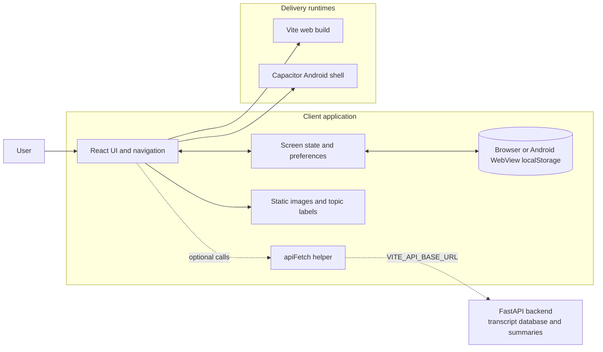
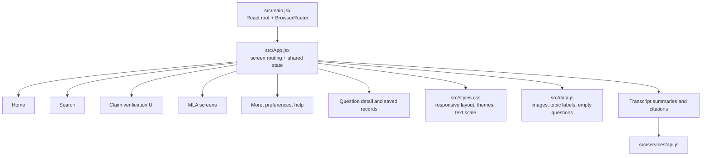
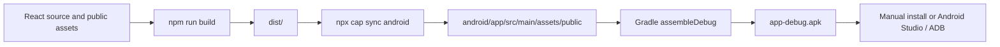

# System architecture

This document describes the current implementation in this repository. It distinguishes implemented behavior from services that are only extension points.

## System context

The React app is the shared application. In a browser, Vite serves or builds it as a static web app. On Android, Capacitor copies the built web assets into the native project and displays them in its WebView. The Android `MainActivity` extends Capacitor's `BridgeActivity`; the Capacitor App plugin provides native back-button handling.

## Frontend layers

### Startup and navigation

- `src/main.jsx` mounts React under `BrowserRouter` and imports the global stylesheet.
- `src/App.jsx` reads the path to choose a screen and uses React Router navigation for screen changes.
- The bottom navigation opens Home, Search, Verify, MLAs, and More.
- A short welcome splash is shown once per browser session. The app listens for Android's native back event through `@capacitor/app`.

### UI and state

- Screen components, route switching, the welcome view, and shared interaction state live in `src/App.jsx`.
- `stored()` initializes settings from `localStorage` and writes changes back. Language, dark mode, text size, and saved question IDs therefore persist in the current browser/WebView on the device.
- Theme colors, responsive layout, safe-area spacing, and text scaling live in `src/styles.css`.
- Static images are served from `public/images/` and referenced with root-relative paths.

## Data and service boundaries

### Current data

- `src/data.js` exports the Assembly image path and four generic trending topic labels.
- The Assembly question collection is intentionally empty (`questions = []`). Search, question details, and saved-question lists therefore have no records to display until verified records are supplied.
- The Home latest-updates area, Saved Searches, and Notifications currently show empty states.
- The claim-verification screen is a frontend demonstration; its current result and source content are not backed by a verification service.
- The MLA screen has selectable topic chips, but no verified MLA directory or related question records are connected.

### Transcript summaries

`src/services/api.js` reads `VITE_API_BASE_URL` at build time. Home requests
`GET /api/videos` and requests `POST /api/videos/{video_id}/summary` when a
summary is opened. The backend summarizes all SQLite transcript segments for
the selected video. Summary sentences cite segment IDs; the backend resolves
those IDs to timestamps and saves the JSON result in `videos.summary`. Tapping
a sentence reveals its timestamp citations, and each timestamp opens the
original YouTube video at that exact time. The source CSV is an export only;
the full database transcript is used so summaries are not limited to CSV row
counts.

The API needs `OPENAI_API_KEY` to generate a new summary. Set `VITE_API_BASE_URL`
to a backend URL reachable by the device, and configure the backend's
`FRONTEND_ORIGINS` for the app origin. A mobile device cannot use its own
`localhost` to reach a development computer.

### Not implemented

- Official Assembly record ingestion, validation, and refresh schedule.
- Authentication and account management.
- Backend persistence or cross-device synchronization for saved items.
- Search history persistence, a notification service, or push notification setup.
- A real claim-checking or source-citation service.

Do not present content as an official Assembly update unless it is populated from a verified source and retains enough source metadata to identify that record.

## Android packaging and release flow

The Windows convenience command `npm run android:build` runs the web build, Capacitor sync, and `gradlew.bat assembleDebug`. The debug APK is created at `android/app/build/outputs/apk/debug/app-debug.apk`. After frontend changes, Android must be synced and rebuilt before an installed APK contains those changes.

## Main repository paths

| Path | Responsibility |
| --- | --- |
| `src/main.jsx` | React entry point and browser router |
| `src/App.jsx` | Screens, navigation, local state, and interactions |
| `src/data.js` | Static image reference, topic labels, and question collection |
| `src/services/api.js` | Optional JSON fetch helper |
| `src/styles.css` | Shared styles, responsive rules, themes, text scaling |
| `public/images/` | Static image assets, including the Kerala emblem |
| `capacitor.config.json` | Capacitor app identity and web asset directory |
| `android/` | Android shell, native configuration, and Gradle build |
