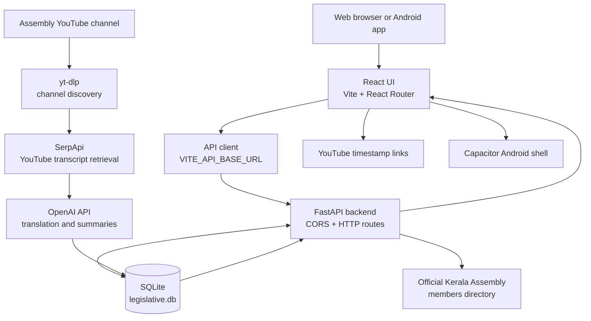

# Niyamasabha AI

Niyamasabha AI is a React and Capacitor application for browsing Kerala Legislative Assembly material. Its FastAPI service stores bilingual video transcripts and summaries in SQLite, searches transcript records, and retrieves the Assembly member directory from the official Kerala Legislative Assembly website.

## System architecture



### Runtime components

| Component | Responsibility |
|---|---|
| React frontend (`src/`) | Screens, navigation, language/theme/text-size preferences, summaries, search results, and member cards. `src/main.jsx` mounts the app; `src/App.jsx` contains screens and UI state. |
| API client (`src/services/api.js`) | Sends JSON requests to the configured FastAPI base URL. Local browser development defaults to `http://127.0.0.1:8001`; an explicit `VITE_API_BASE_URL` overrides it. |
| FastAPI (`backend/main.py`) | Search, video list and summary operations, member-directory retrieval, health status, ingestion job retrieval, compatibility routes, and database migrations needed by request handlers. |
| SQLite (`backend/data/legislative.db`) | Persistent video metadata, source transcript segments, translations, transcript status, and generated summaries. |
| Channel ingestion (`backend/ingest_channel.py`) | Discovers channel videos with `yt-dlp`, retrieves Malayalam captions through SerpApi, translates segments, persists them, then attempts to create missing summaries. This is a batch script, separate from serving the API. |
| Translation (`backend/translator.py`) | Calls OpenAI to translate transcript segments while using neighboring context. |
| Capacitor (`android/`) | Packages the built web frontend as an Android app. It does not contain a separate backend. |
| Official member directory | `GET /api/members` fetches and parses the public Assembly member list and portrait URLs; results are cached in the backend process for one hour. |

### Main data flows

**Transcript ingestion and summary**

1. The channel script discovers video metadata from `YOUTUBE_CHANNEL_URL`.
2. It gets Malayalam transcript segments from SerpApi and translates them to English with OpenAI.
3. It stores each timestamped bilingual segment alongside its video in SQLite.
4. It attempts to generate an English summary from stored transcript text and translate it to Malayalam. Summaries are JSON sentence collections with source segment/timestamp citations and are saved on the `videos` record.
5. The frontend lists transcript videos through `GET /api/videos`. On request, `POST /api/videos/{video_id}/summary?language=en|ml` returns a saved summary or generates and persists one. Clicking a citation opens the YouTube video at the cited second.

Summary creation requires an OpenAI key. The batch ingestion script logs summary-generation failures separately from transcript ingestion; a transcript can therefore be stored even if its summary is still absent.

**Search**

The frontend sends a query to `GET /api/search?q=...`. SQLite searches actual Malayalam/English transcript text and video titles, returning at most one matching timestamped segment per video. This is a substring search, not semantic/vector search. Results link to the original YouTube timestamp.

**Member directory**

The frontend fetches `GET /api/members`. The backend retrieves the official directory at `https://www.niyamasabha.org/codes/members.htm`, parses names, constituency names/numbers, and portrait paths, and returns the source URL and member count. The directory must be reachable by the backend; a fetch or parse failure returns an API error and the frontend may show an unavailable state. Portraits are served by the official site, not copied into the app database.

## Data model

The database file is `backend/data/legislative.db`. It is normally created/initialized by `backend/database.py` and populated by the ingestion script.

### `videos`

| Column | Meaning |
|---|---|
| `video_id` | YouTube video ID; primary key. |
| `title`, `title_english` | Original and translated title. |
| `url` | Source video URL. |
| `published_at` | Publication date/time when available. |
| `duration_seconds` | Video duration when available. |
| `summary` | Saved Malayalam summary JSON (sentences and citations). |
| `summary_english` | Saved English summary JSON (sentences and citations). |
| `transcript_status`, `transcript_error` | Ingestion state and last recorded failure. |
| `discovered_at`, `updated_at` | Discovery and update times. |

### `transcript_segments`

| Column | Meaning |
|---|---|
| `id` | Segment primary key; summary citations refer to it. |
| `video_id` | Parent video foreign key, cascades on delete. |
| `start_seconds`, `end_seconds` | Segment time range in source video. |
| `text`, `text_english` | Original Malayalam and English translation. |

The schema enforces uniqueness for `(video_id, start_seconds, text)` and indexes video and time lookups. Existing databases are migrated to add newer summary/status/title columns when the relevant code runs.

## HTTP API

The backend also exposes interactive API documentation at `/docs` and an OpenAPI schema at `/openapi.json` while running. This table lists routes currently declared in `backend/main.py`.

| Method | Route | Purpose |
|---|---|---|
| `GET` | `/health` | API status, version, and whether an OpenAI key is configured (does not expose the key). |
| `GET` | `/api/members` | Fetch the official Assembly member directory. |
| `GET` | `/api/search?q={query}&limit={n}` | Search video titles and stored transcript segments; `q` must have at least two characters, limit 1–50 (default 30). |
| `GET` | `/api/videos?limit={n}` | List videos with transcript segments and available saved summaries; limit 1–500 (default 10). |
| `POST` | `/api/videos/{video_id}/summary?language=en\|ml` | Return or create and save a cited video summary in the requested language. Requires valid 11-character YouTube ID and OpenAI credentials if generation/translation is needed. |
| `GET` | `/api/jobs/{job_id}` | Read a persisted ingestion job. |
| `GET` | `/api/jobs/{job_id}/segments/{segment_id}` | Read one segment from a persisted job. |
| `GET` | `/api/ml/videos` | Legacy compatibility route: video IDs and original titles. |
| `GET` | `/api/eng/videos` | Legacy compatibility route: video IDs and English titles when available. |
| `GET` | `/api/ml/video/{video_id}` | Legacy compatibility route: video metadata, saved Malayalam summary, and segments. |
| `GET` | `/api/eng/video/{video_id}` | Legacy compatibility route: video metadata, saved English summary, and translated segments. |

The job routes depend on job data being present. The current API route list should be verified in `/docs` before relying on older ingestion instructions or assuming upload routes exist.

### Example requests

```powershell
# Health
Invoke-RestMethod http://127.0.0.1:8001/health

# Search actual transcript records
Invoke-RestMethod 'http://127.0.0.1:8001/api/search?q=education&limit=10'

# List transcribed videos
Invoke-RestMethod 'http://127.0.0.1:8001/api/videos?limit=20'

# Retrieve or generate the English summary
Invoke-RestMethod -Method Post 'http://127.0.0.1:8001/api/videos/VIDEO_ID_HERE/summary?language=en'
```

## Development setup

### Frontend

Requirements: Node.js and npm.

```powershell
npm install
npm run dev
```

Vite prints the local URL, commonly `http://localhost:5173`. For local browser development the frontend defaults to the API at `http://127.0.0.1:8001`.

To use another API, create a root `.env` for Vite:

```dotenv
VITE_API_BASE_URL=http://127.0.0.1:8001
```

Vite environment values are embedded in the frontend build. Rebuild/restart after changing them. For a phone on Wi-Fi, use the development computer's LAN IP as the backend URL and configure the backend CORS origins. `localhost` on a phone refers to the phone itself. For an installed Android app, use a reachable backend host; the default hosted URL is `https://legislative-reporter-api.onrender.com`.

### Backend

Requirements: Python 3.10+ recommended. Install the dependencies used by the backend in a virtual environment (the repository does not currently declare one canonical backend requirements file):

```powershell
cd backend
py -m venv .venv
.\.venv\Scripts\Activate.ps1
python -m pip install fastapi 'uvicorn[standard]' requests python-dotenv python-multipart pypdf yt-dlp openai
```

Create `backend/.env` for local backend settings:

```dotenv
OPENAI_API_KEY=your-openai-api-key
SUMMARY_MODEL=gpt-4o-mini
TRANSLATION_MODEL=gpt-4o-mini
SERPAPI_KEY=your-serpapi-api-key
YOUTUBE_CHANNEL_URL=https://www.youtube.com/@SabhaTV-KLA/videos
TRANSCRIPT_LANGUAGE=ml
MAX_VIDEOS=100
FRONTEND_ORIGINS=http://localhost:5173,http://127.0.0.1:5173
```

Keep real API keys private and out of Git. `SERPAPI_KEY` can also be named `SERPAPI_API_KEY`. OpenAI is needed for translation and summary generation; SerpApi is needed for transcript retrieval in the channel pipeline. The API loads dotenv at startup; the channel ingestion and translator modules load dotenv when imported/run from the backend directory.

Start the API from `backend/`:

```powershell
python -m uvicorn main:app --host 127.0.0.1 --port 8001 --reload
```

Then open `http://127.0.0.1:8001/docs`. If the selected port is occupied or blocked on Windows, choose an available port and set the same port in `VITE_API_BASE_URL`. The app's local browser default is port 8001.

### Populate or inspect SQLite

Initialize the schema from `backend/`:

```powershell
python database.py
```

Run channel ingestion from `backend/` after configuring the required keys and channel URL:

```powershell
python ingest_channel.py
```

The ingestion script processes up to `MAX_VIDEOS`, skips already completed transcripts, and attempts summaries after transcripts are stored. It makes third-party API calls and may incur usage charges. Inspect its logs and database status before increasing the batch size.

Useful SQLite checks:

```sql
SELECT transcript_status, COUNT(*) FROM videos GROUP BY transcript_status;
SELECT COUNT(*) FROM transcript_segments;
SELECT video_id, title, summary IS NOT NULL AS has_malayalam_summary,
       summary_english IS NOT NULL AS has_english_summary
FROM videos ORDER BY published_at DESC;
```

## Android packaging

Capacitor uses `appId: com.niyamasabha.ai`, app name `Niyamasabha AI`, and the Vite output directory `dist`. Requirements include Android Studio/SDK and a compatible JDK/Gradle environment.

```powershell
# Build web assets, sync them into Android, and assemble a debug APK
npm run android:build

# Open the native project in Android Studio
npm run android:open
```

The debug APK is written to `android/app/build/outputs/apk/debug/app-debug.apk`. `npm run android:sync` rebuilds the frontend and synchronizes Capacitor assets without assembling the APK. Android must be rebuilt and reinstalled to update an installed APK; changing the browser development server does not update an installed app. The Android app and browser both call the backend URL configured at build time.

## Current scope and limitations

- Assembly video summaries and transcript search use stored source transcript data. AI summaries and translations can be incomplete or incorrect; citations let users check the original video and timestamp.
- MLA directory information is fetched from the public Assembly site at runtime and is dependent on that site's availability and markup.
- Latest Assembly updates, notifications, saved searches, sign-in/authentication, and live-session scheduling are not backed by corresponding services in this repository; empty/unavailable UI states do not indicate that such data exists.
- The current frontend's claim verification screen is a demonstration, not a verified claim-checking service. Do not treat its displayed sample verdicts or sources as real checks.
- Search is SQLite `LIKE` text matching over indexed application data, not semantic search.
- SQLite is suitable for this local/small deployment. Multi-instance production deployments need shared persistent storage or a managed database, migrations, backups, access controls, and operational monitoring.
- CORS is configured in `backend/main.py`; configure `FRONTEND_ORIGINS` for the exact deployed frontend origins. The API currently has no user authentication layer.

## Repository map

```text
.
├── android/                         Capacitor Android project
├── backend/
│   ├── data/                        SQLite database and persisted job data
│   ├── uploads/                     Backend upload storage directory
│   ├── database.py                  SQLite schema and migrations
│   ├── ingest_channel.py            YouTube channel transcript pipeline
│   ├── main.py                      FastAPI routes and summary/search logic
│   ├── translator.py                OpenAI transcript translation
│   └── export_transcript_segments.py CSV export utility
├── public/images/                   Static frontend images
├── src/
│   ├── services/api.js              Frontend API client
│   ├── App.jsx                      React screens and application behavior
│   ├── data.js                      Frontend data/constants
│   ├── main.jsx                     React entry point
│   └── styles.css                   Responsive and theme styling
├── capacitor.config.json            Capacitor app identity and web output
├── package.json                     Frontend scripts and dependencies
└── README.md                        System architecture and setup guide
```

Some directories, such as the SQLite database and uploads, are generated at runtime and may not be tracked by Git. Keep `.env`, API keys, and sensitive local data out of commits.
